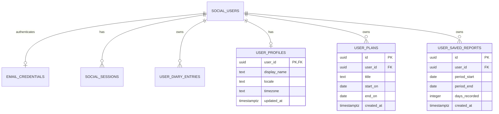

# Account metadata schema extension (Task 3a)

Existing four-table schema was verified on 26 Nov; this additive migration has now been applied to the team's Neon database (main, database nutrivn) on 28 Nov 2026 after disposable PostgreSQL CI passed. No real records have been migrated. It stores minimal profile preferences, scheduling metadata and saved report date ranges/counts. Existing device-only health/profile values are deliberately not uploaded. Any expansion or sync requires separate privacy review, authenticated ownership checks and explicit opt-in; no raw photos or credentials.

Migration: [002_account_metadata.sql](../database/migrations/002_account_metadata.sql). CI uses a disposable PostgreSQL service and synthetic records, re-applies migration for idempotency and tests uniqueness, foreign keys, report bounds and cascade. RLS enabled, no public policies; app must continue to check authenticated owner on every query. Owner role can bypass RLS; SQL owner filters alone do not prove endpoint security. Live catalog verification on 28 Nov: seven public tables (the original four plus user_profiles, user_plans, user_saved_reports); RLS enabled on each of the three new tables; 14 PK/FK/UNIQUE/CHECK constraints verified across the new tables. The migration added only new structures and did not copy or modify existing user records. [Disposable PostgreSQL verification](https://github.com/Tl4826/Myproject/actions/runs/46050197751). API and UI integration and legacy MySQL cleanup remain outstanding; do not claim cloud synchronization for these features.
