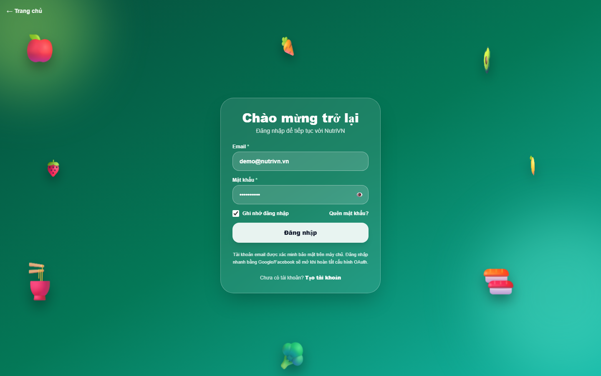
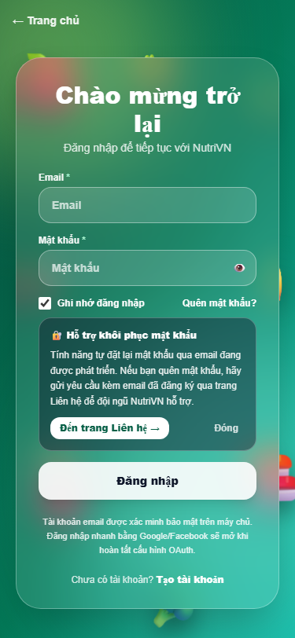
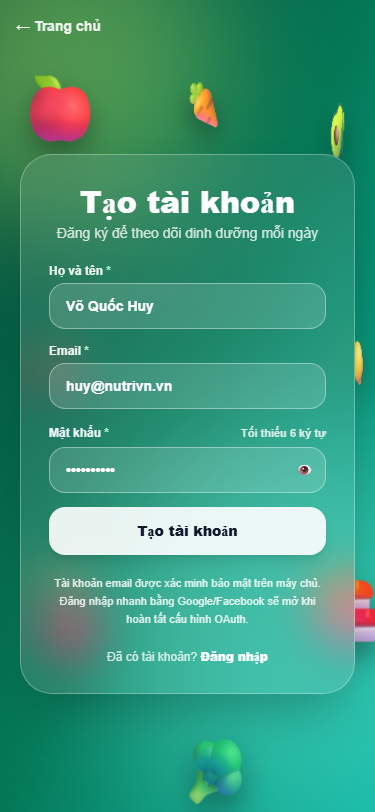

# Ghi Nhận & Xử Lý Góp Ý Từ Nhóm Khác (Task 5b — Peer Feedback)

Tài liệu này tổng hợp các góp ý nhóm NutriVN (Nhóm 1) nhận được từ nhóm khác, quyết định xử lý từng hạng mục, minh chứng **Trước / Sau** và kết quả kiểm thử hồi quy sau khi sửa.

---

## 1. Góp ý từ nhóm CaRảnh — Issue `#38`

- **Nguồn góp ý:** [Issue #38 — Góp ý UI/UX từ nhóm CaRảnh về luồng đăng ký và đăng nhập](https://github.com/Tl4826/Myproject/issues/38) (người gửi: `@hadess-95`, kiểm thử trên bản triển khai ngày `26/11/2026` ở `1440×900` và `375×812`).
- **Nhánh / Phạm vi xử lý:** `fix/huy-auth-ux-feedback` — chỉ chỉnh sửa Frontend (`web/src/components/AuthForm.jsx`, `web/src/app/providers.jsx`, `web/src/app/(protected)/diary/page.jsx`), giữ nguyên 100% logic Backend, Database và AI.

### Bảng tổng hợp quyết định & thay đổi (Trước / Sau)

| # | Vấn đề nhóm CaRảnh nêu | Trước khi sửa | Quyết định & Thay đổi sau khi sửa | Minh chứng Trước / Sau |
| :-: | :--- | :--- | :--- | :--- |
| **1** | **Nút Google và Facebook hiển thị khi chưa cấu hình OAuth** | Cả hai nút *Tiếp tục với Google* và *Tiếp tục với Facebook* vẫn hiển thị dù môi trường chưa cấu hình `NEXT_PUBLIC_GOOGLE_CLIENT_ID` / `NEXT_PUBLIC_FACEBOOK_APP_ID`, bấm vào báo thông báo kỹ thuật *"Chưa điền GOOGLE_CLIENT_ID"*. | **Chấp nhận & đã sửa** trong `web/src/components/AuthForm.jsx`: chỉ hiển thị từng phương thức OAuth khi biến môi trường tương ứng đã cấu hình. Khi chưa cấu hình, ẩn nút không khả dụng và hiển thị ghi chú ngắn thân thiện hướng người dùng đăng nhập/đăng ký qua Email. Đồng thời bổ sung thông báo fallback gọn nếu Google SDK tạm không tải được. | Trước: [Ảnh Google (Issue #38)](https://github.com/letuanlocc/basic_web/blob/00e0fd25f2da4fde4cc6ef9626f5893553495809/docs/feedback/nutrivn/mobile-google.png), [Ảnh Facebook (Issue #38)](https://github.com/letuanlocc/basic_web/blob/00e0fd25f2da4fde4cc6ef9626f5893553495809/docs/feedback/nutrivn/mobile-facebook.png) Sau: [Ảnh Đăng ký 375px](./feedback/issue38-register-filled-375.png), [Ảnh Đăng nhập 1440px](./feedback/issue38-login-filled-1440.png) |
| **2** | **Liên kết "Quên mật khẩu?" bấm vào không phản hồi** | Thẻ `<a href="#">` chỉ gọi `e.preventDefault()`, không mở form hay hướng dẫn nào. | **Chấp nhận & đã sửa** trong `web/src/components/AuthForm.jsx`: chuyển thành `<button type="button">` có `aria-expanded` / `aria-controls`; khi bấm sẽ mở khung hướng dẫn khôi phục mật khẩu ngay trong giao diện, nêu rõ trạng thái tính năng đặt lại tự động đang phát triển kèm nút dẫn thẳng sang trang `/contact` để gửi yêu cầu hỗ trợ và nút Đóng. | Trước: [Ảnh sau khi bấm (Issue #38)](https://github.com/letuanlocc/basic_web/blob/00e0fd25f2da4fde4cc6ef9626f5893553495809/docs/feedback/nutrivn/mobile-forgot-password.png) Sau: [Ảnh Quên mật khẩu 375px](./feedback/issue38-login-forgot-375.png) |
| **3** | **Nhãn trường nhập chỉ nằm trong placeholder, biến mất sau khi gõ** | Các ô Họ và tên, Email, Mật khẩu không có thẻ `<label>` cố định nên sau khi gõ xong không còn nhãn đối chiếu và giảm khả năng truy cập (Accessibility). | **Chấp nhận & đã sửa** trong `web/src/components/AuthForm.jsx`: bổ sung thẻ `<label htmlFor="...">` hiển thị cố định phía trên từng ô (`auth-name`, `auth-email`, `auth-password`), bổ sung gợi ý *"Tối thiểu 6 ký tự"* (`aria-describedby`) khi đăng ký, `aria-pressed` cho nút hiện/ẩn mật khẩu, `autoComplete` chuẩn và `overflow-x-hidden` trên container di động; vẫn giữ nguyên `placeholder` để tương thích 100% bộ test Playwright. | Trước: [Ảnh form đã điền (Issue #38)](https://github.com/letuanlocc/basic_web/blob/00e0fd25f2da4fde4cc6ef9626f5893553495809/docs/feedback/nutrivn/desktop-form-field-labels.png) Sau: [Ảnh Đăng nhập 1440px](./feedback/issue38-login-filled-1440.png), [Ảnh Đăng ký 375px](./feedback/issue38-register-filled-375.png) |

---

## 2. Ảnh chụp minh chứng Sau khi sửa

| Đăng nhập 1440px (có `<label>` cố định, ẩn nút OAuth chưa bật) | Quên mật khẩu 375px (hiện hướng dẫn + nút sang `/contact`) | Đăng ký 375px (có `<label>`, gợi ý 6 ký tự, không nút lỗi) |
| :---: | :---: | :---: |
|  |  |  |

---

## 3. Kết quả kiểm thử hồi quy sau khi sửa

Chạy kiểm thử trực tiếp trên bản build production Next.js (`next build` + `next start`):

- **Build Next.js production (`npm --prefix web run build`):** ✅ PASS (`11/11` trang tĩnh).
- **Build Vercel static export (`VERCEL=1 npm --prefix web run build`):** ✅ PASS (`11/11` trang tĩnh trong `web/out/`).
- **Playwright v2 (`web/tests-v2`, 60 ca kiểm thử — auth, session, routes, diary, nutrition, reports, api-ui, ai-food100):** ✅ **60/60 PASS**.
  - Ghi nhận và xử lý thêm 2 điểm tương thích khi chạy hồi quy:
    1. Đồng bộ listener phím `Escape` trên `/login` & `/dangki` trong `web/src/app/providers.jsx` (`NV2-AUTH-012` PASS).
    2. Chỉnh nhãn đơn vị `(kcal)` ở thẻ tổng quan Desktop trong `web/src/app/(protected)/diary/page.jsx` để tránh trùng strict-mode locator `540 kcal` (`NV2-DIARY-004`, `NV2-DIARY-007` PASS).
- **Security Tests (`web/tests-security/auth-security.spec.cjs`, 12 ca kiểm thử):** **11/12 PASS**.
  - Lưu ý ca `NV2-SEC-011` fail do file test hiện có gọi `login` trực tiếp trong `beforeEach` rỗng mà chưa gọi `register(page)` trước (mock `/api/email-auth` của chính file test trả về `401`); hành vi "không ghi nhớ chỉ dùng `sessionStorage`" đã được xác minh **PASS** ở `NV2-SESSION-002` trong `tests-v2` (không sửa file test của QA để giữ nguyên phạm vi công việc).
