# Báo Cáo Kiểm Thử Responsive & Giao Diện Đa Màn Hình (NutriVN Next.js)

- **Issue liên quan:** `#35`, `#36`, `#37`
- **Ngày kiểm thử:** 26/11/2026
- **Người thực hiện:** Võ Quốc Huy (`Huysadboy2610`)
- **Môi trường:** Next.js 14 App Router + Tailwind CSS 3.4, kiểm thử bằng Chrome Headless qua Playwright trên 3 kích thước chuẩn:
  - **Mobile:** `375 × 812`
  - **Tablet:** `768 × 1024`
  - **Desktop:** `1440 × 900`

---

## 1. Bảng kết quả kiểm thử Responsive & Không tràn ngang (18/18 Đạt)

| # | Trang (Route) | Kích thước | Thao tác kiểm thử | Kết quả mong đợi | Kết quả thực tế (`scrollWidth / innerWidth`) | Trạng thái |
| :-: | :--- | :---: | :--- | :--- | :---: | :---: |
| 1 | Trang chủ (`/`) | 375px | Mở trang chủ chế độ khách | Header gọn, nút điều hướng & CTA không tràn ngang | `375 / 375` (0px tràn) | ✅ Đạt |
| 2 | Trang chủ (`/`) | 768px | Mở trang chủ trên tablet | Tiêu đề, minh họa 3D và thanh điều hướng cân đối | `768 / 768` (0px tràn) | ✅ Đạt |
| 3 | Trang chủ (`/`) | 1440px | Mở trang chủ trên desktop | Bố cục hero thoáng, link `/about`, `/contact`, `/login` rõ ràng | `1440 / 1440` (0px tràn) | ✅ Đạt |
| 4 | Giới thiệu (`/about`) | 375px | Truy cập `/about`, cuộn hết trang | Card giá trị cốt lõi & đội ngũ xếp 1 cột dễ đọc | `375 / 375` (0px tràn) | ✅ Đạt |
| 5 | Giới thiệu (`/about`) | 768px | Truy cập `/about` trên tablet | Lưới 2–3 cột tự co giãn, không che chữ | `768 / 768` (0px tràn) | ✅ Đạt |
| 6 | Giới thiệu (`/about`) | 1440px | Truy cập `/about` trên desktop | Lưới 3 cột tính năng + 4 cột đội ngũ `TEAM_MEMBERS` cân đối | `1440 / 1440` (0px tràn) | ✅ Đạt |
| 7 | Liên hệ (`/contact`) | 375px | Truy cập `/contact`, kiểm tra form | Kênh liên hệ và form xếp dọc 1 cột dễ nhập liệu | `375 / 375` (0px tràn) | ✅ Đạt |
| 8 | Liên hệ (`/contact`) | 768px | Truy cập `/contact` trên tablet | Các trường form hiển thị 2 cột họ tên/email gọn gàng | `768 / 768` (0px tràn) | ✅ Đạt |
| 9 | Liên hệ (`/contact`) | 1440px | Truy cập `/contact` trên desktop | Bố cục 2 cột `lg:grid-cols-12` (5 cột thông tin + 7 cột form) | `1440 / 1440` (0px tràn) | ✅ Đạt |
| 10 | Quét AI & Lộ trình (`/home`) | 375px | Đăng nhập, nhập BMI, mở `/home` | Xếp dọc 1 cột: Hướng dẫn → Quét AI → Ngân sách Calo → Lộ trình | `375 / 375` (0px tràn) | ✅ Đạt |
| 11 | Quét AI & Lộ trình (`/home`) | 768px | Mở `/home` trên tablet | Header 1 hàng gọn, khung nội dung căn giữa dễ đọc | `768 / 768` (0px tràn) | ✅ Đạt |
| 12 | Quét AI & Lộ trình (`/home`) | 1440px | Mở `/home` trên desktop | Bố cục 2 cột `lg:max-w-5xl` (5 cột Quét AI & Calo + 7 cột Lộ trình & FAQ) | `1440 / 1440` (0px tràn) | ✅ Đạt |
| 13 | Nhật ký bữa ăn (`/diary`) | 375px | Thêm 2 món ăn, mở `/diary` | Trạng thái calo + tổng quan + danh sách món xếp dọc rõ ràng | `375 / 375` (0px tràn) | ✅ Đạt |
| 14 | Nhật ký bữa ăn (`/diary`) | 768px | Mở `/diary` trên tablet | Từng món hiển thị đầy đủ macro, bộ chọn bữa và nút xóa | `768 / 768` (0px tràn) | ✅ Đạt |
| 15 | Nhật ký bữa ăn (`/diary`) | 1440px | Mở `/diary` trên desktop | Bố cục 2 cột (4 cột Tổng quan Calo/Macro + 8 cột Nhật ký bữa ăn) | `1440 / 1440` (0px tràn) | ✅ Đạt |
| 16 | Báo cáo 7 ngày (`/baocao`) | 375px | Mở `/baocao` sau khi ghi món | Biểu đồ 7 cột + nút lưu + lịch sử hiển thị trọn vẹn | `375 / 375` (0px tràn) | ✅ Đạt |
| 17 | Báo cáo 7 ngày (`/baocao`) | 768px | Mở `/baocao` trên tablet | Nhãn ngày, cột calo và đường mục tiêu không chồng chữ | `768 / 768` (0px tràn) | ✅ Đạt |
| 18 | Báo cáo 7 ngày (`/baocao`) | 1440px | Mở `/baocao` trên desktop | Bố cục 2 cột (7 cột Biểu đồ 7 ngày + 5 cột Lịch sử báo cáo) | `1440 / 1440` (0px tràn) | ✅ Đạt |

---

## 2. Bằng chứng ảnh chụp 3 kích thước màn hình

### 2.1. Trang Quét AI & Lộ trình (`/home`) — Bố cục 2 cột Desktop
| Mobile (375px) | Tablet (768px) | Desktop (1440px) |
| :---: | :---: | :---: |
| 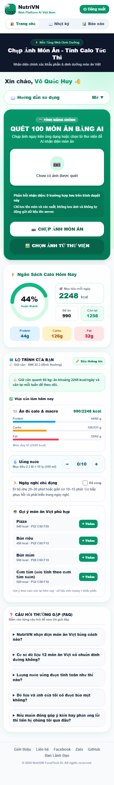 | 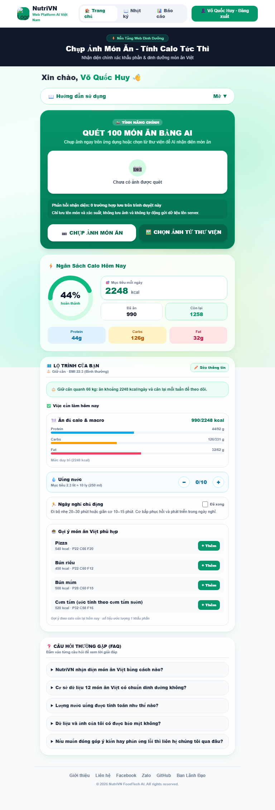 | 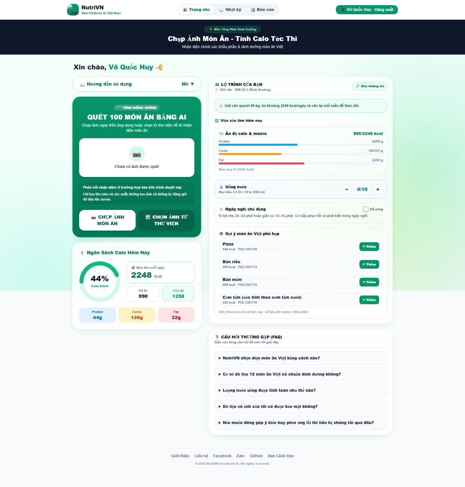 |

### 2.2. Trang Nhật ký bữa ăn (`/diary`) — Bố cục 2 cột Desktop
| Mobile (375px) | Tablet (768px) | Desktop (1440px) |
| :---: | :---: | :---: |
| 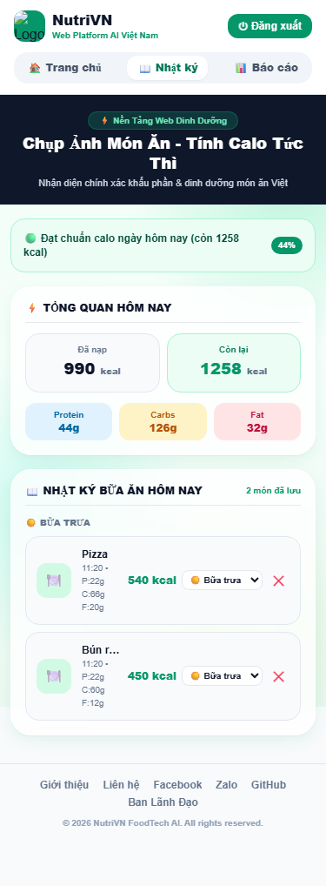 | 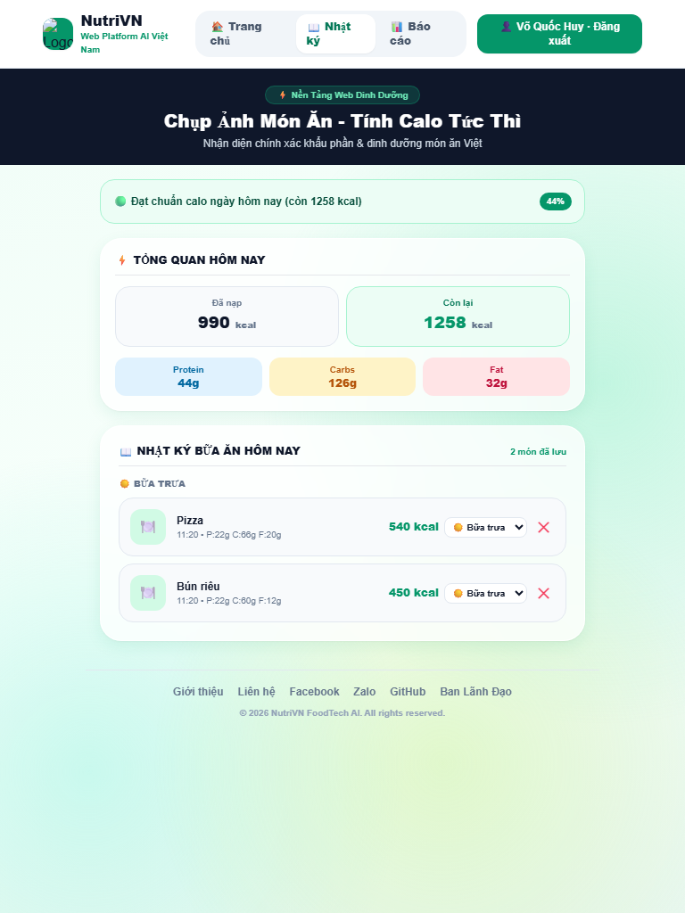 | 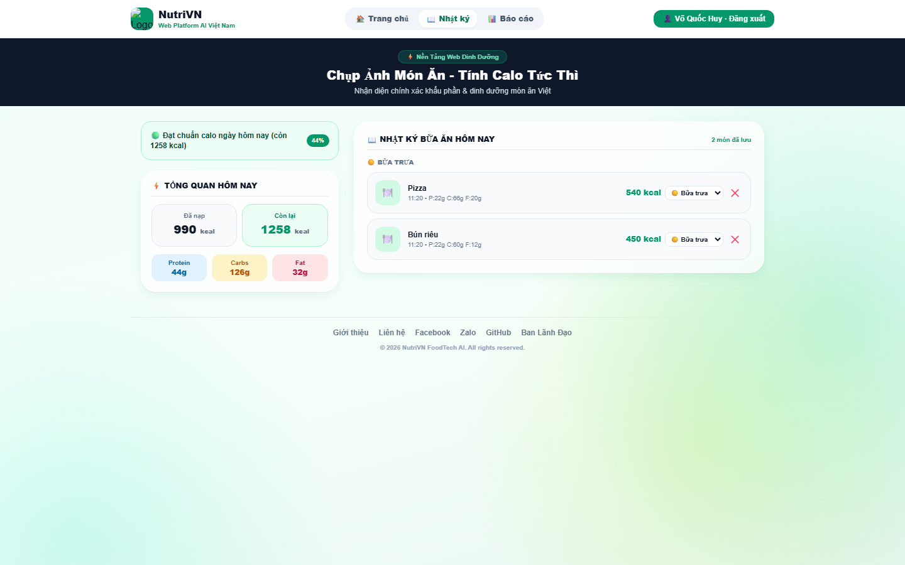 |

### 2.3. Trang Báo cáo xu hướng Calo 7 ngày (`/baocao`) — Bố cục 2 cột Desktop
| Mobile (375px) | Tablet (768px) | Desktop (1440px) |
| :---: | :---: | :---: |
| 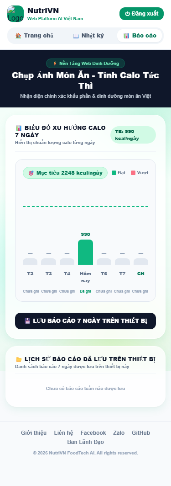 | 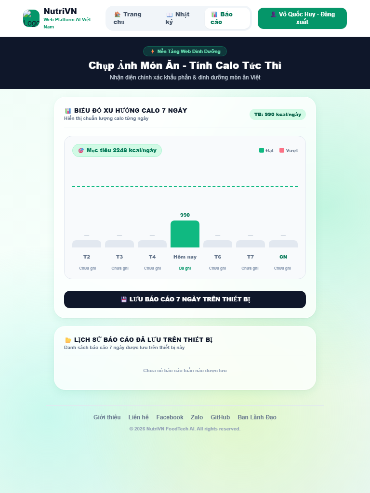 | 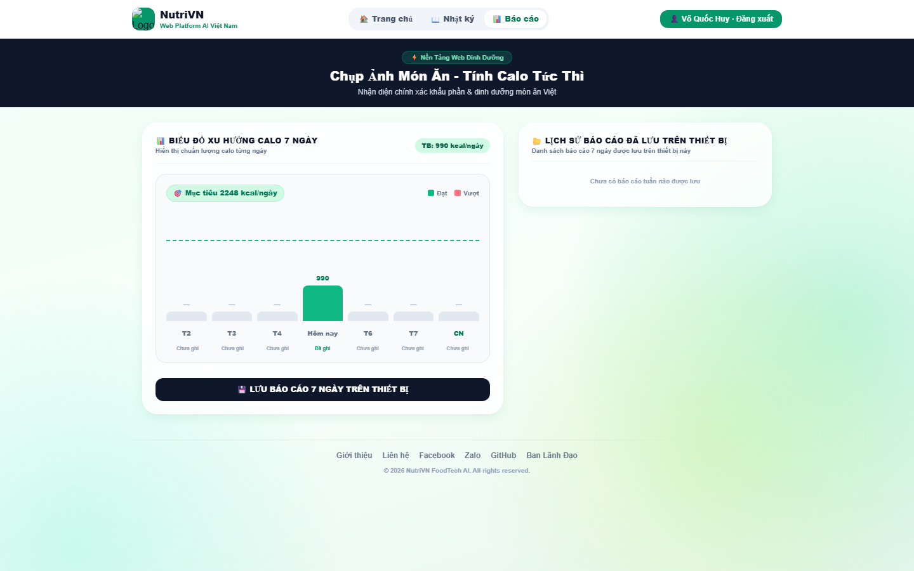 |

### 2.4. Trang Giới thiệu (`/about`)
| Mobile (375px) | Tablet (768px) | Desktop (1440px) |
| :---: | :---: | :---: |
|  | 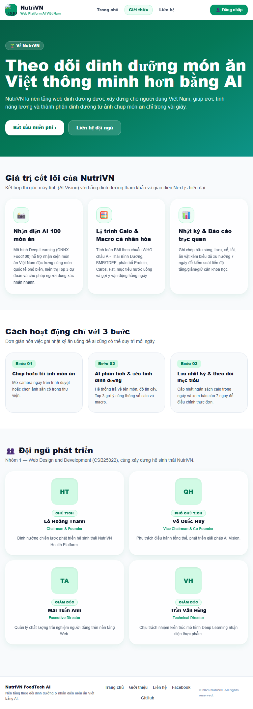 | 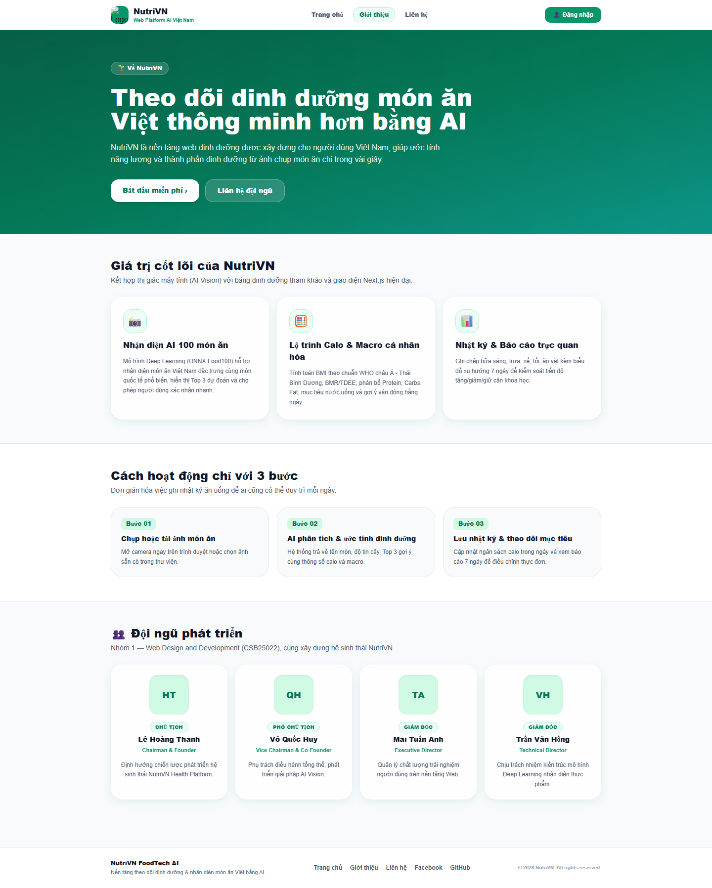 |

### 2.5. Trang Liên hệ (`/contact`)
| Mobile (375px) | Tablet (768px) | Desktop (1440px) |
| :---: | :---: | :---: |
| 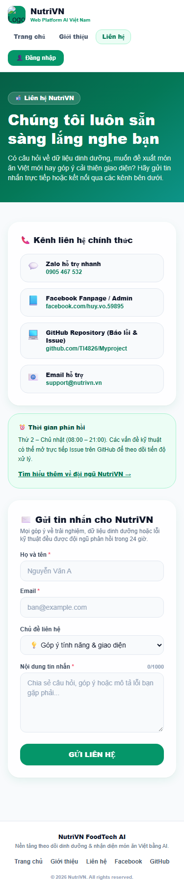 | 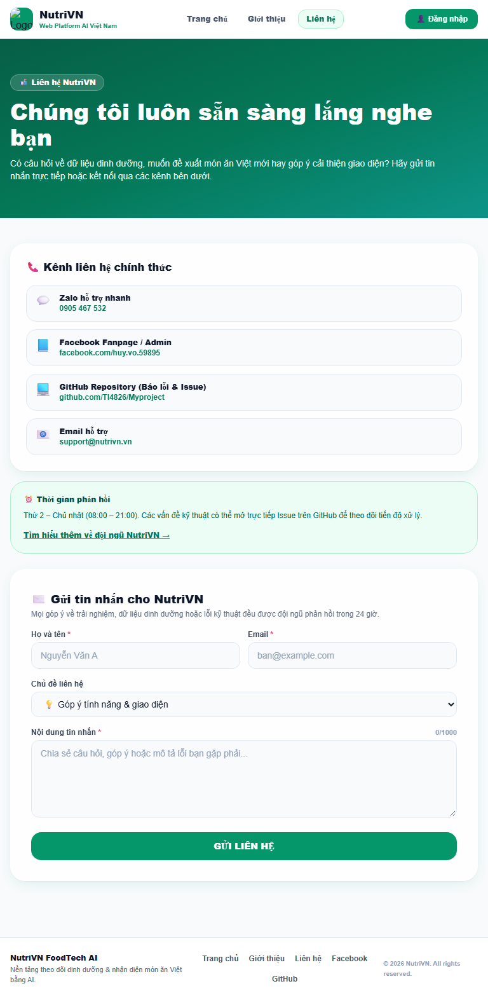 | 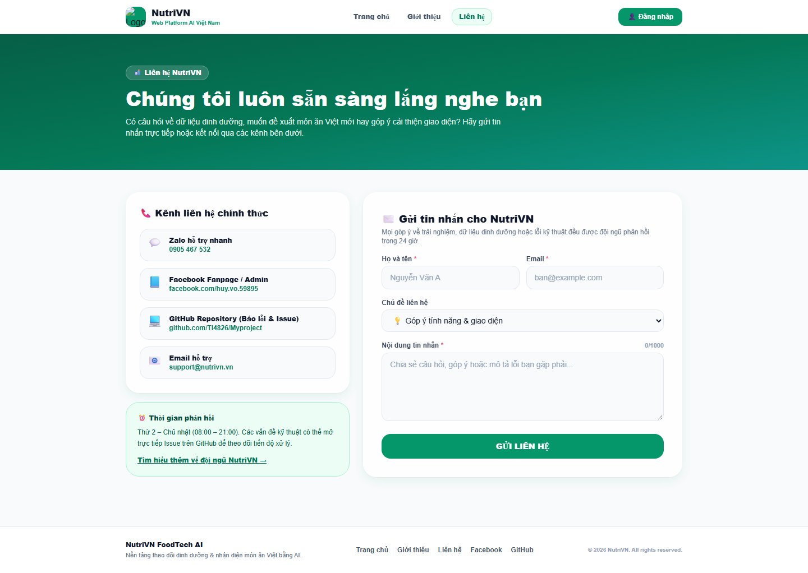 |

### 2.6. Trang chủ công khai (`/`)
| Mobile (375px) | Tablet (768px) | Desktop (1440px) |
| :---: | :---: | :---: |
| 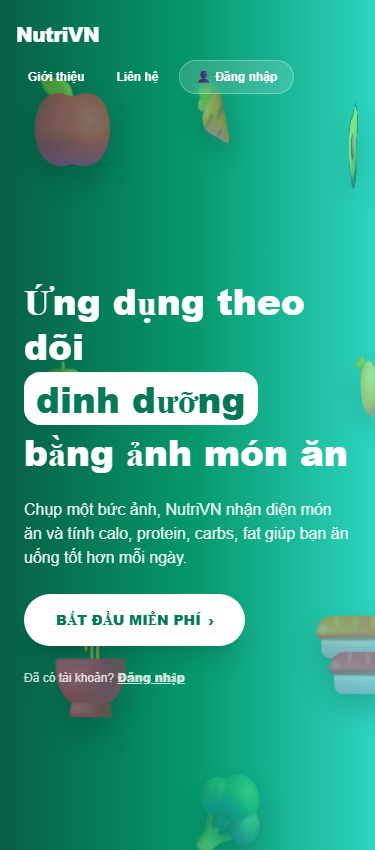 | 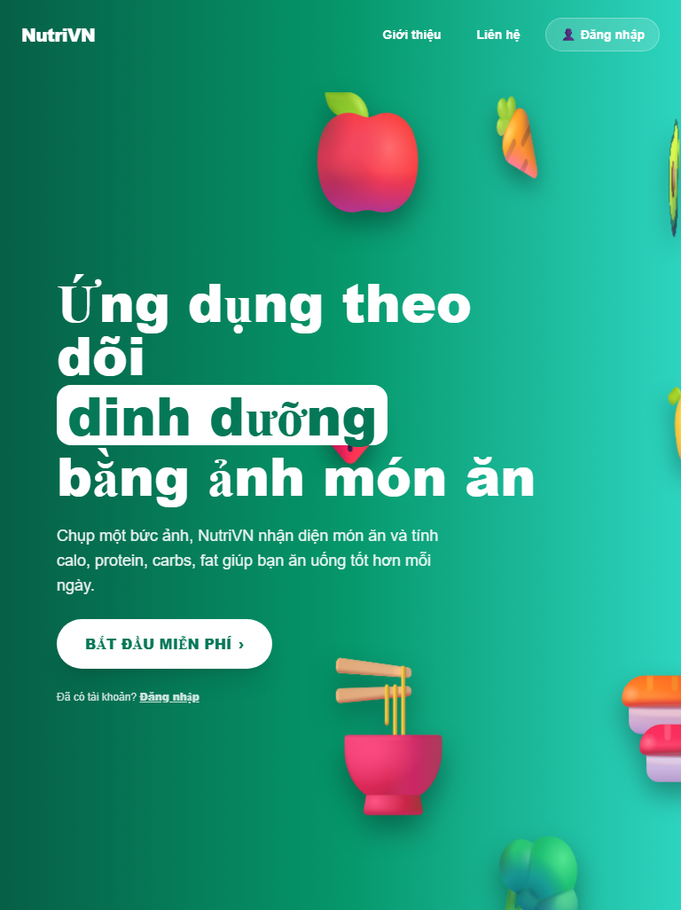 | 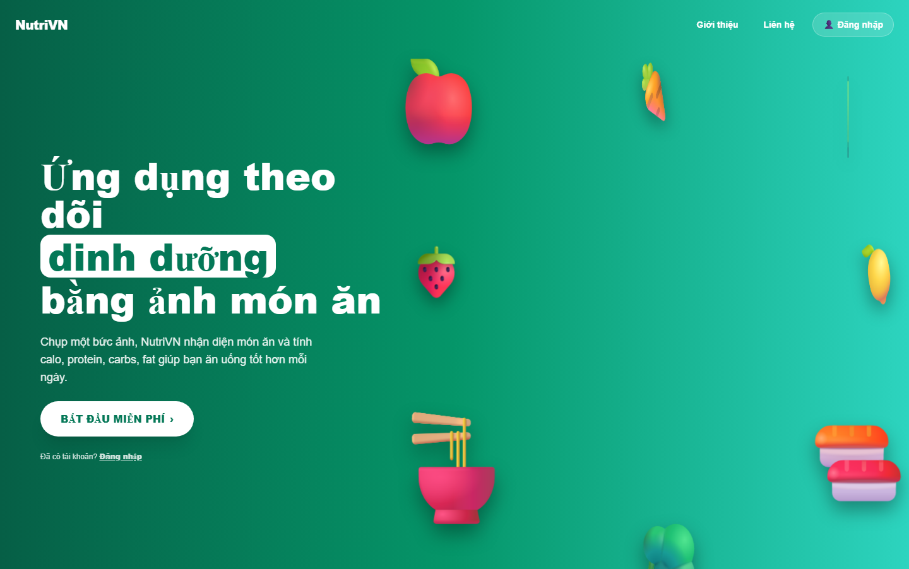 |
