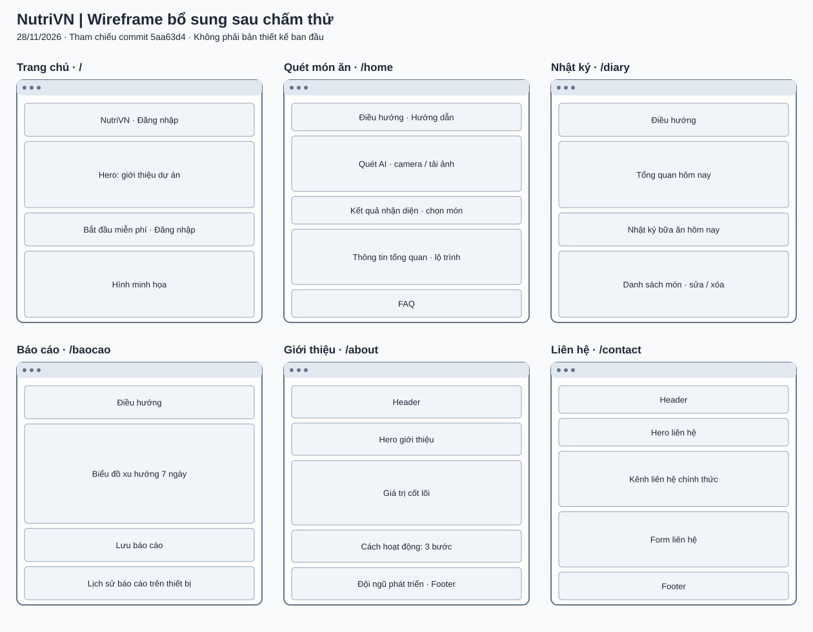

# NutriVN – wireframes and grading crosswalk

Prepared on 28 November 2026 after the trial assessment, based on main at `5aa63d4`. These are retrospective low-fidelity wireframes, not evidence of design work completed before implementation. The team should attach any authentic earlier wireframes if available.

| Route | Existing implementation | Existing responsive evidence |
|---|---|---|
| / | [Landing](../web/src/app/(guest)/page.jsx) | [375](responsive/landing-375.png) · [1440](responsive/landing-1440.png) |
| /home | [Scan](../web/src/app/(protected)/home/page.jsx) | [375](responsive/home-375.png) · [1440](responsive/home-1440.png) |
| /diary | [Diary](../web/src/app/(protected)/diary/page.jsx) | [375](responsive/diary-375.png) · [1440](responsive/diary-1440.png) |
| /baocao | [Reports](../web/src/app/(protected)/baocao/page.jsx) | [375](responsive/baocao-375.png) · [1440](responsive/baocao-1440.png) |
| /about | [About](../web/src/app/about/page.jsx) | [375](responsive/about-375.png) · [1440](responsive/about-1440.png) |
| /contact | [Contact](../web/src/app/contact/page.jsx) | [375](responsive/contact-375.png) · [1440](responsive/contact-1440.png) |

Wireframes represent major content regions rather than exact styling, ordering or breakpoint geometry. See [responsive report](RESPONSIVE_REPORT.md) for the existing 375/768/1440 evidence. All screenshots are existing repository evidence, not new tests. Review actual screens and record any discrepancy before claiming design conformity.

## Remaining work

- Review wireframe with team and add any original design artifacts.
- Run the updated Lighthouse workflow; verify /home HTML and JSON, route, scores and artifact links. Distinguish mock API from production.
- Update milestone deadlines and document actual planning dates based on issue/commit history; do not backdate or invent meetings.
- Give substantive review to another team's real project and retain their actual response.
- Review database, Next.js runtime migration, and observability changes separately to avoid breaking current deployment.
