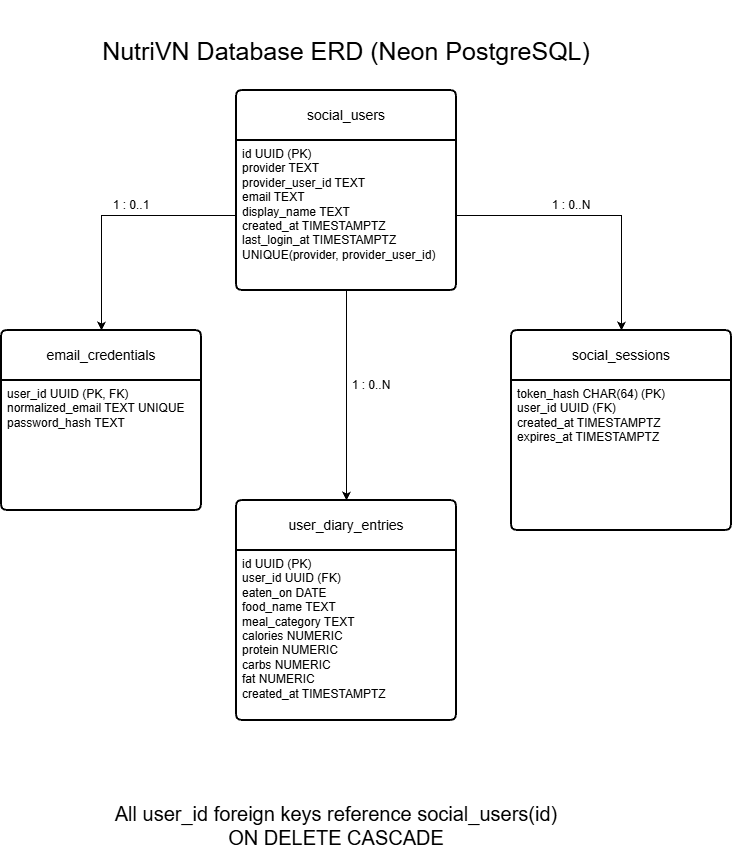

# NutriVN — Database schema (Neon PostgreSQL)

**Database:** `nutrivn` · **Branch:** `main` · **Schema:** `public`  
**Schema verified:** 26/11/2026 by reading Neon metadata (no user records queried).

ERD contributed by Tuấn Anh; diagram carried over unchanged from commit `bd7ea82`. This document supplements the diagram with column types, nullability, defaults and constraints from the live database.

## 1. Tables and attributes

### social_users
Stores user identities for email, Google and Facebook authentication.

| Column | PostgreSQL type | Nullable | Default / key |
|---|---|---|---|
| id | UUID | No | PK; gen_random_uuid() |
| provider | TEXT | No | Part of composite UNIQUE |
| provider_user_id | TEXT | No | Part of composite UNIQUE |
| email | TEXT | Yes | — |
| display_name | TEXT | No | Empty string |
| avatar_url | TEXT | Yes | — |
| created_at | TIMESTAMPTZ | No | now() |
| last_login_at | TIMESTAMPTZ | No | now() |

Constraints: PRIMARY KEY (id); UNIQUE (provider, provider_user_id); CHECK provider IN ('google', 'facebook', 'email').

### email_credentials
Stores credentials for email authentication; each account can have at most one credential record.

| Column | PostgreSQL type | Nullable | Default / key |
|---|---|---|---|
| user_id | UUID | No | PK, FK → social_users.id |
| normalized_email | TEXT | No | UNIQUE |
| password_hash | TEXT | No | — |

Constraints: PRIMARY KEY (user_id); UNIQUE (normalized_email); CHECK normalized_email = lower(trim(normalized_email)); FOREIGN KEY (user_id) REFERENCES social_users(id) ON DELETE CASCADE.

### social_sessions
Stores hashed session identifiers and expiry timestamps.

| Column | PostgreSQL type | Nullable | Default / key |
|---|---|---|---|
| token_hash | CHAR(64) | No | PK |
| user_id | UUID | No | FK → social_users.id |
| created_at | TIMESTAMPTZ | No | now() |
| expires_at | TIMESTAMPTZ | No | — |

Constraints: PRIMARY KEY (token_hash); CHECK token_hash matches 64 lowercase hexadecimal characters; FOREIGN KEY (user_id) REFERENCES social_users(id) ON DELETE CASCADE.

### user_diary_entries
Stores individual meal diary records linked to a user. Nutrient values may be unknown (NULL); the schema does not require measured portion sizes.

| Column | PostgreSQL type | Nullable | Default / key |
|---|---|---|---|
| id | UUID | No | PK; gen_random_uuid() |
| user_id | UUID | No | FK → social_users.id |
| eaten_on | DATE | No | — |
| food_name | TEXT | No | — |
| meal_category | TEXT | No | 'other' |
| calories | NUMERIC | Yes | — |
| protein | NUMERIC | Yes | — |
| carbs | NUMERIC | Yes | — |
| fat | NUMERIC | Yes | — |
| created_at | TIMESTAMPTZ | No | now() |

Constraints: PRIMARY KEY (id); FOREIGN KEY (user_id) REFERENCES social_users(id) ON DELETE CASCADE; each of calories, protein, carbs and fat must be NULL or greater than or equal to zero.

## 2. Relationships

| Parent | Child | Cardinality | Foreign key |
|---|---|---|---|
| social_users | email_credentials | 1 : 0..1 | user_id (also PK) |
| social_users | social_sessions | 1 : 0..N | user_id |
| social_users | user_diary_entries | 1 : 0..N | user_id |

Every child row references exactly one user. All three foreign keys use ON DELETE CASCADE. The email credential primary key prevents multiple credential records for one user.

## 3. Scope and privacy

The verified public schema contains four tables, 25 columns and 16 named primary-key, foreign-key, unique and check constraints. There are no separate Food, BMI, Reports or AI Predictions tables in this schema. The ERD represents stored database entities, not every application feature.

This document includes schema metadata only: no real user rows, passwords, session tokens, connection strings or other secrets. No database migration or application code change is required for this documentation.
