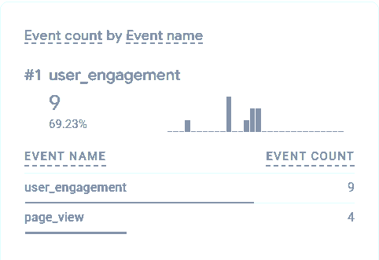
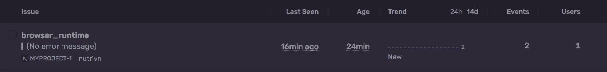

# NutriVN — Task 4 verification evidence (26 November 2026)

Issue #32; submission branch main. Implementation PR #33; API routing fix #34; production verification PRs #49, #50, #51.

## Lighthouse

Scores are Performance / Accessibility / Best Practices / SEO.

| Route | CI (local mock API) | Production | Production host |
|---|---|---|---|
| / | 100 / 100 / 96 / 100 | 87 / 100 / 96 / 100 | nutrivn-main.vercel.app |
| /diary | 100 / 96 / 96 / 100 | 100 / 96 / 96 / 100 | nutrivn-myproject.vercel.app |
| /baocao | 100 / 96 / 96 / 100 | 99 / 96 / 96 / 100 | nutrivn-myproject.vercel.app |

- [Local CI HTML/JSON](https://github.com/Tl4826/Myproject/actions/runs/45643857681), artifact nutrivn-lighthouse.
- [Public production HTML/JSON and smoke checks](https://github.com/Tl4826/Myproject/actions/runs/45798437764/artifacts/15106531216).
- [Authenticated production score summaries and consent checks](https://github.com/Tl4826/Myproject/actions/runs/45799243828/artifacts/15106048066). Raw authenticated production reports were deliberately not published to avoid session metadata. Preserve downloaded artifacts separately before expiry.
- Performance 87 on the public landing is a remaining improvement opportunity; no claim that every Lighthouse audit finding is fixed.

## GA4 dashboard (team-provided screenshot)

4 page_view and 9 user_engagement events. Image cropped and reduced in palette to omit account and navigation information. The screenshot proves dashboard reception, not independent attribution of each event to a domain. On nutrivn-myproject production the automated browser check confirmed default-off, opt-in page_view and decline. Third-party requests were intercepted for this consent test.

## Sentry dashboard (team-provided screenshot)

MYPROJECT-1 / browser_runtime, 2 events, 1 user as displayed by Sentry. Cropped and palette-reduced. Browser consent and allowlisted payload tests passed. The server transport separately sent diagnostic_test tagged preview, ingestion HTTP 200, event ID 7a5b550868944640983d44de92c9aaf6; see [diagnostic evidence](https://github.com/Tl4826/Myproject/actions/runs/45799739417/artifacts/15105923999). This was not a deliberately induced production failure or an independent view of that event in Sentry Issues.

## Functional regression

- Health HTTP 200, 100 classes; synthetic PNG prediction returned Top 3.
- Public pizza image tested via actual UI: HTTP 200, Top 1 pizza, Top 3 pizza/carrot_cake/breakfast_burrito; selected pizza and diary visible. One photo is not a statistical model accuracy measure.
- QA account register 201, wrong password and unregistered email 401, session verification 200, anonymous diary 401, account-scoped diary API CRUD passed and QA meal removed; logout 200. Synthetic QA accounts may remain. Email-account UI diary remains browser-local; no universal cross-device sync claim.
- GA4/Sentry environment variables were verified by name on nutrivn-myproject. nutrivn-main did not have them at the time of checking; no credentials or DSNs are included here.
- No real personal images, passwords, session tokens or health profiles are included in this report. This is a course prototype, not a clinical nutrition tool.

## Final CI recheck after accessibility and email diary integration

PR #53 corrected text contrast and font sizes. PR #54 integrated email accounts with the existing Neon diary API; both merged. All six PR #54 checks passed. The latest [Lighthouse CI HTML/JSON](https://github.com/Tl4826/Myproject/actions/runs/45816700702/artifacts/15115672824) uses local mock API, not production: landing 99/100/96/100; diary 100/100/100/100; reports 99/100/96/100. Both production deployments at commit 4b46f73 returned HTTP 200 with 100 classes. Cross-browser local regression [passed](https://github.com/Tl4826/Myproject/actions/runs/45816701285); the [separate production regression](https://github.com/Tl4826/Myproject/actions/runs/45823545267) also passed in PR #55. Legacy browser meals are not silently migrated; newly saved meals are account-scoped and no diary image thumbnail is transmitted. Historical production scores above remain the measured results at the time of those audits.

## Production recheck after PR #54

[Actual workflow](https://github.com/Tl4826/Myproject/actions/runs/45823545267), [JSON summary](https://github.com/Tl4826/Myproject/actions/runs/45823545267/artifacts/15119220960): verified two independent authenticated sessions, visibility of a synthetic Neon row in both, report calculated from the server entry, UI edit/delete persisted, and all nine horizontal-overflow checks at 375/768/1440 px across home, diary and reports. Synthetic meal removed; both sessions revoked; a synthetic account may remain. No real data or telemetry opt-in. Authenticated production Lighthouse diary 85/100/100/100, reports 100/100/96/100; numeric summaries only. Performance varies across runs and is not claimed to be perfect. Saved profile and archived reports and legacy meals remain local. OAuth and the individual diagnostic event's dashboard view were not independently rechecked.

## Final rubric follow-up — scan route and diagnostics

- [PR #63](https://github.com/Tl4826/Myproject/pull/63) was merged; its actual [mock API Lighthouse artifact](https://github.com/Tl4826/Myproject/actions/runs/46049567502/artifacts/15224256124) records /home 100/100/96/100 (default mobile configuration, per PR verification). This is not production evidence.
- The follow-up audit adds a separate desktop configuration for /home, checks the final URL and device, and retains home.html/home.json (mobile) and home-desktop.html/home-desktop.json. New measurements must be taken from the completed workflow artifact, not inferred from previous scores.
- [PR #67](https://github.com/Tl4826/Myproject/pull/67) merged bounded route/service context, descriptive fixed error messages and server duration buckets. [Task 4 CI](https://github.com/Tl4826/Myproject/actions/runs/46050030578) passed, but this does not establish GA4 or Sentry dashboard reception for the new payload. Track #66 for public-route opt-in, private-route exclusion and actual redacted dashboard evidence.
- Keep #62 and #32 open until team review and authenticated production /home measurement are recorded. Do not publish raw authenticated production reports or private data.

## 28 November 2026 — post-PR #73 verification

- [Task 4 CI](https://github.com/Tl4826/Myproject/actions/runs/46100299544) audit job succeeded; [HTML/JSON artifact](https://github.com/Tl4826/Myproject/actions/runs/46100299544/artifacts/15245097768) is available. Recorded /home scores (Performance/Accessibility/Best Practices/SEO): mobile 100/100/96/100; desktop 100/100/100/100. Local mock API only.
- Vercel production nutrivn-myproject was READY at main commit 420c539 (deployment dpl_3gpn8XWdzRrhrMwjiKNrKNxbrSXB); a 30-minute error/fatal runtime-log query returned no groups. This does not prove all requests succeeded.
- The production regression workflow now includes authenticated /home mobile and desktop audits with origin, route and form-factor checks and numeric-only evidence. No raw private reports are uploaded. Production scores must be taken from a successful actual run, not inferred from the local CI scores.
- Sentry dashboard: individual preview diagnostic_test event 7a5b550868944640983d44de92c9aaf6 and new route/service/duration context still require independent dashboard verification; GA4 new public route coverage and private-route exclusion evidence remain pending (#66). Keep #32 open until required evidence is verified.

## Production acceptance recheck and Sentry dashboard — 28 November 2026

[PR #76](https://github.com/Tl4826/Myproject/pull/76) merged after the production regression workflow and both Vercel checks passed. [Workflow 46116160281](https://github.com/Tl4826/Myproject/actions/runs/46116160281), [numeric JSON evidence](https://github.com/Tl4826/Myproject/actions/runs/46116160281/artifacts/15251229313), measured nutrivn-myproject.vercel.app at 06:20 UTC (13:20 ICT).

| Authenticated production route | Device | Performance | Accessibility | Best Practices | SEO |
|---|---|---:|---:|---:|---:|
| /home | Mobile | 90 | 100 | 96 | 100 |
| /home | Desktop | 100 | 100 | 100 | 100 |
| /diary | Mobile | 87 | 100 | 100 | 100 |
| /baocao | Mobile | 100 | 100 | 96 | 100 |

All 19 logged verification checks passed: health (100 classes), two authenticated sessions, server diary synchronization, weekly report, nine responsive checks, edit/delete persistence, and four Lighthouse audits. Numeric summaries only; no raw authenticated reports. Synthetic QA account may remain; its test meal was deleted and the workflow completed session cleanup.

User-provided Sentry screenshot dated 28 November 2026 shows [MYPROJECT-2 / diagnostic_test](https://nutrivn.sentry.io/issues/7868692522/?environment=preview&project=4512497296474112), environment preview, one event, zero users, event ID prefix 7a5b5508, matching the earlier diagnostic receipt. This establishes dashboard reception of the earlier synthetic server diagnostic; it does not establish all privacy settings or the newer #66 context fields. Preserve the cropped screenshot alongside the submission evidence (not uploaded to this repository in this commit).

Original production scan measurement and earlier diagnostic receipt gaps are now addressed. Keep #32 open pending the additional #66 public-route GA4/private-route exclusion and new diagnostic-context dashboard verification; team wireframe review remains tracked separately in #62.
